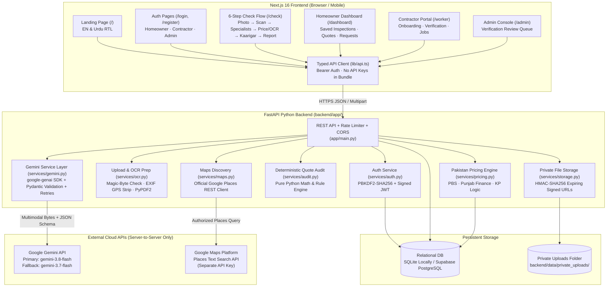
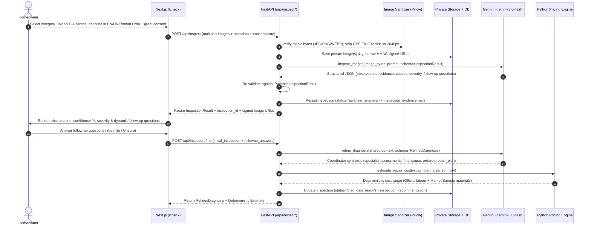
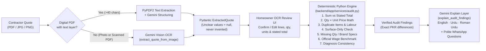
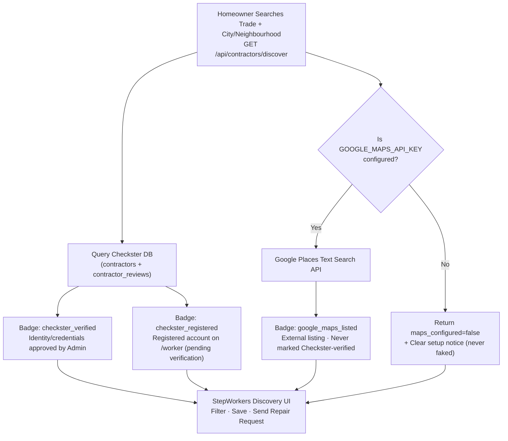
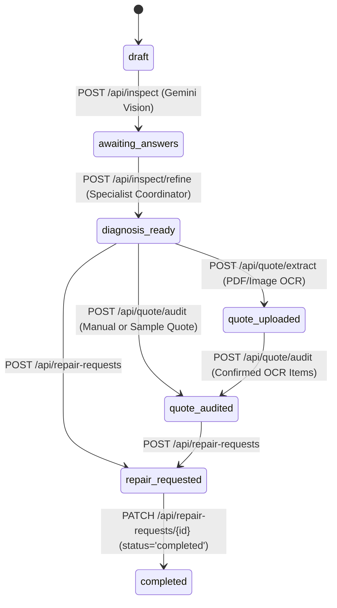
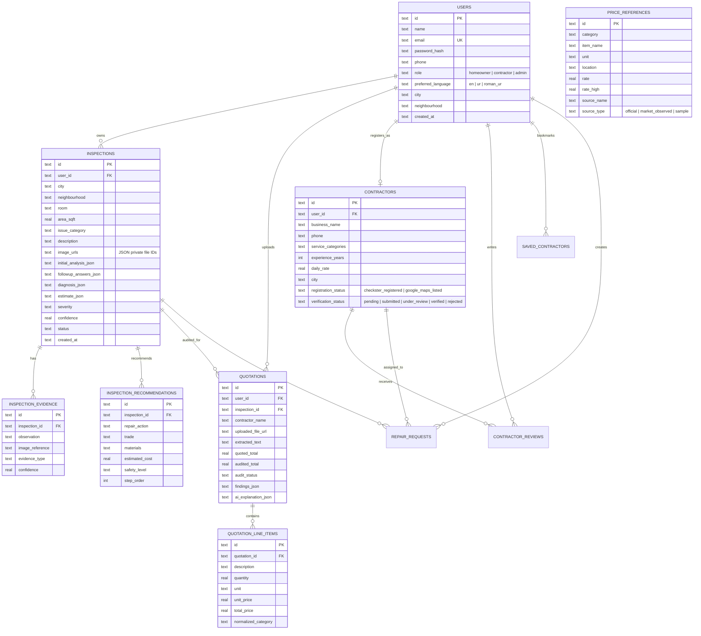

# Checkster — AI-Powered Home Inspection & Contractor Quote Auditing Platform

> **Pehle samjhein, phir paise dein.** *(Understand it before you pay.)*


-4285F4)

-brightgreen)

Checkster is an independent technical second opinion built for Pakistani homeowners facing common residential maintenance problems—damp walls (*seelan*), salt efflorescence (*shora*), concealed plumbing leaks, roof seepage, and plaster/structural cracks (*darar*). Before a homeowner agrees to expensive or surface-only repairs, Checkster analyses photographs of the issue, asks targeted diagnostic questions, estimates fair costs using traceable government labour benchmarks, extracts and audits contractor quotations line-by-line using deterministic Python rules, and connects homeowners with local tradespeople.

### Quick Start (2 Terminals)

```powershell
# Terminal 1 — FastAPI Backend (http://localhost:8000)
cd backend
Copy-Item .env.example .env   # Add your Google AI Studio GEMINI_API_KEY
pip install -r requirements.txt
uvicorn app.main:app --reload --host 0.0.0.0 --port 8000

# Terminal 2 — Next.js Frontend (http://localhost:3000)
Copy-Item .env.example .env.local
npm install
npm run dev
```

> **Preliminary Guidance Notice:** All AI-generated diagnoses in Checkster are preliminary visual assessments intended to help homeowners ask informed questions. They are **not** certified structural or building engineering inspections. Any major structural crack or active electrical hazard requires an on-site qualified professional.

---

## Table of Contents

1. [Product Overview & Core Principles](#1-product-overview--core-principles)
2. [System Architecture](#2-system-architecture)
3. [End-to-End Dataflow Diagrams](#3-end-to-end-dataflow-diagrams)
   - [3.1 Visual Home Inspection & Specialist Coordinator Flow](#31-visual-home-inspection--specialist-coordinator-flow)
   - [3.2 Quotation OCR, Deterministic Audit & AI Explanation Flow](#32-quotation-ocr-deterministic-audit--ai-explanation-flow)
   - [3.3 Local Contractor Discovery & Trust Tiers](#33-local-contractor-discovery--trust-tiers)
   - [3.4 Inspection Lifecycle State Machine](#34-inspection-lifecycle-state-machine)
4. [AI & Model Understanding Guide (For Partners & Engineers)](#4-ai--model-understanding-guide-for-partners--engineers)
   - [4.1 Model Selection & Live Verification](#41-model-selection--live-verification)
   - [4.2 How Multimodal Vision Inspection Works](#42-how-multimodal-vision-inspection-works)
   - [4.3 Coordinator & Multi-Specialist Reasoning](#43-coordinator--multi-specialist-reasoning)
   - [4.4 Document OCR & Multilingual Quote Understanding](#44-document-ocr--multilingual-quote-understanding)
   - [4.5 Why AI Never Computes Prices (Deterministic vs. Generative Split)](#45-why-ai-never-computes-prices-deterministic-vs-generative-split)
   - [4.6 Schema Validation, Retries, Timeouts & Fallback Engineering](#46-schema-validation-retries-timeouts--fallback-engineering)
5. [Pakistan-Specific Pricing Intelligence](#5-pakistan-specific-pricing-intelligence)
6. [Database Schema & Entity-Relationship Diagram](#6-database-schema--entity-relationship-diagram)
7. [Security & Privacy Architecture](#7-security--privacy-architecture)
8. [Repository Code Map](#8-repository-code-map)
9. [Environment Configuration & API Keys Setup](#9-environment-configuration--api-keys-setup)
10. [Local Development Setup (Frontend + Backend)](#10-local-development-setup-frontend--backend)
11. [REST API Reference](#11-rest-api-reference)
12. [Testing & Quality Assurance](#12-testing--quality-assurance)
13. [Deployment Guide](#13-deployment-guide)

---

## 1. Product Overview & Core Principles

Homeowners in Pakistan routinely encounter two problems during home repairs:
1. **Misdiagnosis / Surface-Only Work:** Contractors frequently scrape and repaint a damp wall without locating or fixing the concealed leaking pipe, exterior rain ingress, or failed Damp Proof Course (DPC)—causing the *seelan* to return within months.
2. **Opaque Quotations (*Takhmeena*):** Handwritten or typed quotes often bundle labour and materials without square-foot measurements, omit waterproofing brand/coat specifications, double-count labour, or contain arithmetic mismatches.

Checkster enforces five strict engineering principles:
- **Evidence Before Diagnosis:** Separate what is *visually observable* in the photo from *suspected causes*, attach confidence scores (`0.0–1.0`), and explicitly list what a camera cannot see inside a wall.
- **Zero Fake Agent Theatre:** Specialist perspectives (Plumbing, Masonry, Waterproofing, Electrical, General) are grounded strictly in visual observations and homeowner answers—never pre-scripted demo chats.
- **Zero LLM Arithmetic:** Gemini extracts text and explains audit findings in plain English, Urdu, and Roman Urdu, while **100% of totals, variances, and daily-wage benchmarks are computed deterministically in Python**.
- **Source-Backed Pricing:** Official government figures (Pakistan Bureau of Statistics SPI, Finance Department Punjab) are strictly separated from market-observed rates and unverified sample material estimates.
- **Honest Contractor Badges:** External businesses from Google Maps Platform (`google_maps_listed`) are never marked as Checkster-registered (`checkster_registered`) or Checkster-verified (`checkster_verified`).

---

## 2. System Architecture

Checkster uses a clean decoupled full-stack architecture:
- **Frontend:** Next.js 16 (App Router), React 19, TypeScript, Tailwind CSS v4, bilingual English + RTL Nastaliq Urdu (`Noto Nastaliq Urdu`).
- **Backend:** FastAPI (Python 3.12), Pydantic v2 strict schema validation, Pillow image sanitization, PyPDF2 digital PDF extraction, `httpx` async client.
- **AI Provider:** Official Google Gen AI Python SDK (`google-genai`) calling `gemini-3.8-flash` (configurable via `GEMINI_MODEL`) with automatic failover to `gemini-3.7-flash` (`GEMINI_FALLBACK_MODEL`).
- **Persistence & Storage:** Normalized relational database (`backend/app/database.py` running zero-config local SQLite + full Supabase PostgreSQL & RLS migration in `supabase/migrations/001_checkster_schema.sql`) + private upload storage served only via expiring HMAC-SHA256 signed URLs.



---

## 3. End-to-End Dataflow Diagrams

### 3.1 Visual Home Inspection & Specialist Coordinator Flow

When a homeowner uploads 1–4 photos of a problem on `/check`, the data flows through two distinct AI reasoning stages followed by deterministic cost estimation:



### 3.2 Quotation OCR, Deterministic Audit & AI Explanation Flow

Checkster strictly separates **reading a quote** (OCR/Vision), **checking the numbers** (deterministic Python), and **explaining the findings** (bilingual AI):



### 3.3 Local Contractor Discovery & Trust Tiers



### 3.4 Inspection Lifecycle State Machine

Every inspection is persisted in the `inspections` table and transitions cleanly across stages so refreshing the browser or logging out never loses progress:



---

## 4. AI & Model Understanding Guide (For Partners & Engineers)

All AI interaction lives in **one reusable service layer**: [`backend/app/services/gemini.py`](backend/app/services/gemini.py), backed by strict Pydantic schemas in [`backend/app/schemas.py`](backend/app/schemas.py).

### 4.1 Model Selection & Live Verification

- **SDK:** Official Google Gen AI SDK (`google-genai`), using the async client (`client.aio.models.generate_content`). No OpenAI SDK or key is required.
- **Model Verification:** Before selecting a default model, [`backend/scripts/list_models.py`](backend/scripts/list_models.py) queries `client.models.list()` for models supporting `generateContent` on the configured Google AI Studio key, followed by live responsiveness checks.
- **Primary Model (`GEMINI_MODEL`):** `gemini-3.8-flash` (shorthand `3.8-flash` is automatically normalized by `_normalise_model()`). Supports fast multimodal image/PDF understanding and native JSON Schema structured outputs.
- **Zero-Delay Multi-Model Failover Chain (`GEMINI_FALLBACK_MODEL`):** `gemini-3.5-flash-lite,gemini-3.5-flash,gemini-3.7-flash,gemini-3.1-flash-lite`. The SDK's internal retry loop is capped at `HttpRetryOptions(attempts=1)` and `GeminiService` iterates across the model chain *before* sleeping—if the primary model hits a `429` free-tier quota limit or `503` demand spike, it immediately switches to the next available model within seconds.
- **Live `.env` Hot-Reloading:** `GeminiService` automatically detects `backend/.env` changes on disk and rebuilds the `genai.Client` without requiring a server restart.
- **Zero Hardcoding:** Changing `GEMINI_MODEL` in `backend/.env` updates every vision, coordinator, OCR, and explanation call across the entire platform without code changes.

### 4.2 How Multimodal Vision Inspection Works (`inspect_images`)

- **Input:** 1–4 sanitized JPEG images (`types.Part.from_bytes`) + category hint + room + city + homeowner description (in English, Urdu, or Roman Urdu).
- **System Guardrails (`SYSTEM_INSPECTOR`):**
  1. Only describe what is **visually observable** (e.g., blistering paint, dark moisture line near skirting, white crystalline *shora*, diagonal stepped crack).
  2. Keep `observations` (visual evidence) strictly separate from `possible_causes` (hypotheses).
  3. Calibrate `confidence` and `probability` honestly (`0.0–1.0`); never present a photo check as a confirmed structural inspection.
  4. Never advise painting over dampness before fixing the moisture source.
  5. **Electrical Safety First:** If moisture is near switches/sockets or scorch marks/exposed wires appear, emit immediate safety warnings to switch off the main breaker and call a qualified electrician—never give DIY electrical instructions.
- **Output Schema (`InspectionResult`):**
  - `image_usable` (`bool`), `issue_category`, `summary_en`, `summary_ur`
  - `observations`: list of `{ observation, evidence, location_hint, confidence }`
  - `possible_causes`: list of `{ cause, probability, explanation, specialist }`
  - `severity` (`low` | `moderate` | `high` | `critical`) + `severity_reason`
  - `additional_questions`: 2–4 targeted `{ id, question_en, question_ur, why }` items whose answers will disambiguate the competing causes
  - `recommended_next_steps`, `safety_warnings`, `limitations`

### 4.3 Coordinator & Multi-Specialist Reasoning (`refine_diagnosis`)

Instead of running 5 separate expensive LLM calls or displaying a fake scripted group chat, Checkster uses a **Single-Pass Shared-Context Coordinator Pattern**:
- **Inputs:** The validated `InspectionResult` JSON from the photo + the homeowner's answers to the follow-up questions (e.g., `{"bathroom": "yes", "rain": "no"}`).
- **Logical Specialists Available:**
  1. `plumbing` (concealed PPRC/GI pipe joints, drain traps, pressure testing)
  2. `masonry` (brickwork, Damp Proof Course / DPC, *shora* plaster spalling, crack width)
  3. `waterproofing` (roof parapet sealing, external wall ingress, chemical membranes)
  4. `electrical` (wet conduits, breaker isolation)
  5. `general` (ventilation, condensation, surface finishing)
- **Coordinator Responsibility:** Selects *only* the relevant specialists for the case, records each specialist's grounded reasoning (`SpecialistAssessment`), resolves any conflict in `conflicts_resolved` (for example, why masonry re-plastering must wait until plumbing leak repair and 1–2 weeks of wall drying finish), and outputs an ordered `repair_plan` (`RepairAction[]` with `step`, `trade`, `materials`, `estimated_days`, `safety_level`) plus `professional_inspection_required`.

### 4.4 Document OCR & Multilingual Quote Understanding (`extract_quote_*`)

Contractor quotations in Pakistan arrive as WhatsApp photos of handwritten Urdu/English chits or PDFs.
- **Hybrid Pipeline:**
  1. If the upload is a PDF, `extract_text_from_pdf()` checks for an embedded digital text layer via `PyPDF2`. If present, `extract_quote_from_text()` structures it at `temperature=0.0`.
  2. If the upload is a JPG/PNG/WEBP photo or a scanned image-only PDF, `extract_quote_from_image()` sends the document bytes directly to Gemini multimodal vision at `temperature=0.0`.
- **Anti-Hallucination Rules (`SYSTEM_QUOTE`):**
  - Converts Urdu/Eastern-Arabic numerals (`۰۱۲۳۴۵۶۷۸۹`) to standard digits.
  - **Never invents missing quantities, unit rates, or totals:** if a contractor wrote `"Chemical waterproof coating — Rs 22,000"` with no square footage, `quantity` is `null`, `unit` is `""`, and if any number is smudged/illegible, `total_price` is `null`, `unclear=true`, and `needs_user_review=true`.
  - Before running the audit, the frontend presents an **OCR Confirmation & Edit Screen** so the homeowner can verify or correct every extracted line.

### 4.5 Why AI Never Computes Prices (Deterministic vs. Generative Split)

LLMs can miscalculate arithmetic or hallucinate market rates. Checkster enforces a strict boundary:

| Task | Handled By | File |
|---|---|---|
| Reading handwritten/printed quote lines | Gemini Vision / PyPDF2 | `backend/app/services/gemini.py`, `ocr.py` |
| Summing line items & comparing against stated grand total | **Pure Python** | `backend/app/services/audit.py` |
| Checking `quantity × unit_price == total_price` | **Pure Python** | `backend/app/services/audit.py` |
| Detecting duplicate items, double labour, missing units, surface-only scope, unspecified waterproofing coats | **Pure Python** | `backend/app/services/audit.py` |
| Benchmarking labour against PBS / Punjab official daily wages | **Pure Python** | `backend/app/services/audit.py`, `pricing.py` |
| Checking quote scope against inspection `primary_trade` | **Pure Python** | `backend/app/services/audit.py` |
| Translating & explaining the already-computed findings in friendly English, Urdu & Roman Urdu | Gemini (`explain_audit_findings`) | `backend/app/services/gemini.py` |

### 4.6 Schema Validation, Retries, Timeouts & Fallback Engineering

Every call inside `GeminiService` goes through four reliability layers:
1. **Constrained Decoding:** Passes `response_mime_type="application/json"` and `response_schema=<PydanticClass>` directly in `GenerateContentConfig`.
2. **Server-Side Re-Validation:** Parses the JSON string and runs `schema.model_validate(...)` via Pydantic v2 (enforcing bounds like `0.0 <= confidence <= 1.0` and strict `Literal` enums). Invalid payloads raise `AIBadResponse` (`HTTP 502`).
3. **Hard Timeouts:** Configures `HttpOptions(timeout=...)` and `asyncio.wait_for(..., timeout=GEMINI_TIMEOUT + 5)`, mapping hangs to `AITimeout` (`HTTP 504`).
4. **Exponential Backoff + Model Fallback:** Retries transient `408 / 429 / 500 / 502 / 503 / 504` errors up to `GEMINI_MAX_RETRIES` times with jittered backoff, then falls back from `GEMINI_MODEL` (`gemini-3.8-flash`) to `GEMINI_FALLBACK_MODEL` (`gemini-3.7-flash`). Persistent `429` errors return `AIRateLimited` (`HTTP 429`) with a clear user-facing message.

---

## 5. Pakistan-Specific Pricing Intelligence

Implemented in [`backend/app/services/pricing.py`](backend/app/services/pricing.py) and seeded into the `price_references` table:

| Category | Item | Rate (PKR) | Source | Classification |
|---|---|---|---|---|
| Labour | Mason (*raj mistri*) | Rs 1,987 / day | Pakistan Bureau of Statistics (SPI), national avg, Jan 2026 | `official` |
| Labour | Plumber | Rs 1,754 / day | Pakistan Bureau of Statistics (SPI), national avg, Jan 2026 | `official` |
| Labour | Painter | Rs 1,709 / day | Pakistan Bureau of Statistics (SPI), national avg, Jan 2026 | `official` |
| Labour | Electrician | Rs 279 / point | Pakistan Bureau of Statistics (SPI), national avg, Jan 2026 | `official` |
| Labour | Skilled worker (govt. works) | Rs 2,000 / day | Finance Department Punjab notification, Jul–Dec 2026 | `official` |
| Material | Portland Cement (50 kg bag) | Rs 1,350 – 1,480 / bag | PBS Weekly SPI tracked market range, Jan 2026 | `market_observed` |
| Equipment | Plumbing line pressure test | Rs 800 – 1,500 / test | Market-observed diagnostic check | `market_observed` |
| Material | Plaster / Paint / Waterproofing / Pipe fittings | Area-based ranges | Placeholder estimates (explicitly badged in UI) | `sample` |
| Transport | Local material fetch & rubble disposal | Rs 500 – 1,200 / trip | Placeholder allowance (explicitly badged in UI) | `sample` |

- **KP / Peshawar Location Awareness:** When a homeowner selects Peshawar, Swat, Mardan, Abbottabad, Kohat, or Nowshera, Checkster uses the **PBS national average** as the primary official benchmark rather than silently treating Punjab provincial notifications as KP law, and explicitly notes when KP C&W Market Rate System (MRS) schedules apply.
- **Job Cost vs. Daily Wage:** Daily wages are never shown as a total repair price; `estimate_repair_cost()` combines `estimated_days × trade_wage` + diagnostic equipment + area-scaled materials + transport.

---

## 6. Database Schema & Entity-Relationship Diagram

Checkster automatically initializes a local relational SQLite database at `backend/data/checkster.db` on startup and includes a full **Supabase PostgreSQL + Row-Level Security (RLS)** migration at [`supabase/migrations/001_checkster_schema.sql`](supabase/migrations/001_checkster_schema.sql).



---

## 7. Security & Privacy Architecture

- **API Key Isolation:** `GEMINI_API_KEY` and `GOOGLE_MAPS_API_KEY` live exclusively in `backend/.env` (git-ignored). `/api/health` reports booleans (`api_key_configured: true`) and never returns secret strings.
- **Password & Session Security:** Passwords are hashed with `PBKDF2-HMAC-SHA256` (200,000 iterations + 16-byte cryptographic salt). Sessions use HMAC-SHA256 signed Bearer tokens (`services/auth.py`), with dual compatibility for `SUPABASE_JWT_SECRET`.
- **EXIF GPS Stripping & Magic-Byte Validation:** Uploaded images are decoded with Pillow (`sanitize_image`), transposed, converted to RGB (stripping camera EXIF/GPS coordinates), and downscaled before touching storage or Gemini. Non-image payloads disguised with `.jpg` extensions are rejected (`HTTP 400`).
- **Private Storage & Expiring Signed URLs:** Uploaded home photos and contractor quotes are stored in `backend/data/private_uploads/` and served only via `/api/files/{file_id}?expires=...&sig=...` signed with HMAC-SHA256.
- **Explicit User Consent & Data Deletion:** Sending photos/documents to Gemini requires `consent=true`. Users can delete individual inspections or permanently delete their account and all private files from `/dashboard`.

---

## 8. Repository Code Map

```text
checkster-v2/
├── app/
│   ├── layout.tsx                 # Root layout (LangProvider + AuthProvider + Nastaliq/Nunito fonts)
│   ├── page.tsx                   # Homeowner landing page
│   ├── check/page.tsx             # Inspection & quote audit flow entry
│   ├── worker/page.tsx            # Contractor onboarding & dashboard entry
│   ├── login/page.tsx             # Login + token-based password reset
│   ├── register/page.tsx          # Registration (Homeowner / Contractor / Admin)
│   ├── dashboard/page.tsx         # Persistent user dashboard & privacy controls
│   └── admin/page.tsx             # Admin contractor verification console
├── components/
│   ├── check/
│   │   ├── flow.tsx               # End-to-end state orchestration + URL/session resume
│   │   ├── step-photo.tsx         # Multi-photo upload, voice/text input, AI consent
│   │   ├── step-scan.tsx          # Live Gemini Vision observations, confidence & severity
│   │   ├── step-experts.tsx       # Dynamic follow-up Q&A + Specialist Coordinator synthesis
│   │   ├── step-price.tsx         # Location-aware cost estimate + Quote OCR review & audit
│   │   ├── step-workers.tsx       # Checkster Directory + Google Maps Places discovery
│   │   ├── step-booked.tsx        # Printable PDF & WhatsApp shareable full report
│   │   ├── shell.tsx              # Progress bar, mascot guide & mobile-first action bar
│   │   ├── wall.tsx               # Photo viewer & SVG fallback illustration
│   │   └── map.tsx                # Neighbourhood visual map component
│   ├── worker/worker-app.tsx      # Contractor profile registration, verification upload & job actions
│   ├── landing/                   # Hero & educational sections
│   └── site/                      # Header, Footer, Mascot, OfficialTag, DemoTag, Illustrations
├── lib/
│   ├── api.ts                     # Typed API client for all FastAPI endpoints
│   ├── auth-context.tsx           # React auth context & token persistence
│   ├── audit.ts                   # Client-side deterministic quote check fallback
│   ├── data.ts                    # Static UI constants, cities, rooms & labelled demo items
│   ├── handoff.ts                 # Landing-to-check photo handoff helper
│   └── i18n.tsx                   # Bilingual { en, ur } context & RTL dir switching
├── backend/
│   ├── app/
│   │   ├── main.py                # FastAPI application & all route handlers
│   │   ├── schemas.py             # Pydantic v2 schemas for structured AI outputs
│   │   ├── database.py            # SQLite relational schema, connection manager & seeding
│   │   └── services/
│   │       ├── gemini.py          # Google Gen AI SDK wrapper, prompts, retries & fallback
│   │       ├── ocr.py             # Image sanitization & PyPDF2 extraction
│   │       ├── audit.py           # Deterministic Python quote auditing engine
│   │       ├── pricing.py         # Pakistan pricing database & project cost estimator
│   │       ├── maps.py            # Official Google Maps Platform Places integration
│   │       ├── auth.py            # Password hashing, JWT tokens & role guards
│   │       └── storage.py         # Private file storage & HMAC signed URLs
│   ├── scripts/list_models.py     # Checks Gemini models available to your API key
│   ├── tests/
│   │   ├── test_core.py           # 17 unit tests (math, pricing, schemas, sanitization)
│   │   └── test_api.py            # 5 end-to-end integration tests (auth, journey, admin)
│   ├── requirements.txt
│   └── .env.example
└── supabase/migrations/
    └── 001_checkster_schema.sql   # Production PostgreSQL schema + RLS policies
```

---

## 9. Environment Configuration & API Keys Setup

### Backend (`backend/.env`)

Copy `backend/.env.example` to `backend/.env`:

| Variable | Required | Default | Purpose |
|---|---|---|---|
| `GEMINI_API_KEY` | **Yes** | — | Google AI Studio API key (`https://aistudio.google.com/apikey`) |
| `GEMINI_MODEL` | No | `gemini-3.8-flash` | Primary multimodal + structured-output Gemini model |
| `GEMINI_FALLBACK_MODEL` | No | `gemini-3.7-flash` | Automatic failover model on `503` / `404` |
| `GEMINI_TIMEOUT` | No | `60` | Per-call timeout in seconds |
| `GEMINI_MAX_RETRIES` | No | `3` | Retry attempts on transient errors |
| `GOOGLE_MAPS_API_KEY` | Optional | `""` | **Separate** Google Cloud credential with **Places API** enabled |
| `CHECKSTER_AUTH_SECRET` | Recommended | dev default | Secret key for signing JWTs and private file URLs |
| `CORS_ORIGINS` | No | `http://localhost:3000,...` | Allowed frontend origins |

> **Credential Separation Warning:** Google AI Studio (`GEMINI_API_KEY`) credentials are completely separate from Google Maps Platform (`GOOGLE_MAPS_API_KEY`) credentials. Never pass your Gemini key to Google Maps endpoints. If `GOOGLE_MAPS_API_KEY` is omitted, Checkster displays a transparent setup notice while keeping the Checkster Contractor Directory fully functional.

### Frontend (`.env.local`)

Copy `.env.example` to `.env.local`:

```env
NEXT_PUBLIC_API_URL=http://localhost:8000
```

---

## 10. Local Development Setup (Frontend + Backend)

### Prerequisites
- **Python** 3.11+
- **Node.js** 20+

### Terminal 1 — Start the FastAPI Backend

```powershell
cd backend
pip install -r requirements.txt
python scripts/list_models.py   # Optional: verify your Gemini key & available models
uvicorn app.main:app --reload --host 0.0.0.0 --port 8000
```
- Backend API: `http://localhost:8000`
- Interactive Swagger UI: `http://localhost:8000/docs`
- Health Check: `http://localhost:8000/api/health`

### Terminal 2 — Start the Next.js Frontend

```powershell
# From checkster-v2/ root
Copy-Item .env.example .env.local -ErrorAction SilentlyContinue
npm install
npm run dev
```
- Web App: `http://localhost:3000`

---

## 11. REST API Reference

| Endpoint | Method | Auth | Description |
|---|---|---|---|
| `/api/health` | `GET` | Public | Returns AI provider, active model, fallback model, and key/Maps status (never exposes keys) |
| `/api/files/{file_id}` | `GET` | Signed URL | Serves private inspection photos & quote PDFs via `expires` + HMAC `sig` |
| `/api/auth/register` | `POST` | Public | Creates `homeowner`, `contractor`, or `admin` account and returns Bearer token |
| `/api/auth/login` | `POST` | Public | Verifies email/password and returns Bearer token |
| `/api/auth/me` | `GET` | Bearer | Returns current user profile |
| `/api/auth/profile` | `PATCH` | Bearer | Updates name, phone, city, neighbourhood, or preferred language |
| `/api/auth/password-reset/request` | `POST` | Public | Generates a time-limited password reset token |
| `/api/auth/password-reset/confirm` | `POST` | Public | Resets password with valid token |
| `/api/auth/account` | `DELETE` | Bearer | Deletes user account, records, and all private uploaded files |
| `/api/inspect` | `POST` | Optional | Sanitizes 1–4 photos, runs Gemini Vision `InspectionResult`, persists inspection |
| `/api/inspect/refine` | `POST` | Optional | Runs Specialist Coordinator `RefinedDiagnosis` + deterministic `Estimate` |
| `/api/inspect/ask` | `POST` | Public | Answers free-form homeowner questions in English & Urdu |
| `/api/inspections` | `GET` | Bearer | Lists logged-in user's saved inspections |
| `/api/inspections/{id}` | `GET` / `PATCH` / `DELETE` | Owner/Admin | Retrieves full report (with evidence, recommendations & quotes), updates, or deletes |
| `/api/estimate` | `POST` | Public | Computes deterministic repair cost range from a repair plan, area, and city |
| `/api/pricing/references` | `GET` | Public | Lists traceable labour, material, equipment & transport references |
| `/api/quote/extract` | `POST` | Optional | Extracts contractor quote from PDF or image (PyPDF2 / Gemini Vision OCR) |
| `/api/quote/audit` | `POST` | Optional | Runs 9 deterministic Python audit checks and saves quotation record |
| `/api/quote/explain` | `POST` | Public | Generates English, Urdu & Roman Urdu explanations of deterministic findings |
| `/api/quotations` | `GET` | Bearer | Lists user's saved quotations & audit results |
| `/api/contractors/discover` | `GET` | Public | Returns `checkster_verified`, `checkster_registered`, and `google_maps_listed` providers |
| `/api/contractors` | `POST` | Bearer | Creates or updates contractor profile |
| `/api/contractors/me` | `GET` | Bearer | Contractor dashboard data (profile, reviews, incoming repair requests) |
| `/api/contractors/me/verification` | `POST` | Bearer | Uploads verification notes/documents (`verification_status='submitted'`) |
| `/api/contractors/{id}/reviews` | `POST` | Bearer | Submits a 1–5 star rating and review |
| `/api/saved-contractors` | `GET` / `POST` / `DELETE` | Bearer | Manages bookmarked contractors |
| `/api/repair-requests` | `GET` / `POST` / `PATCH` | Bearer | Creates homeowner repair requests and handles contractor accept/counter/reject |
| `/api/admin/overview` | `GET` | Admin | Platform metrics + contractor verification queue |
| `/api/admin/contractors/{id}/verify` | `PATCH` | Admin | Sets `under_review`, `verified`, or `rejected` |

---

## 12. Testing & Quality Assurance

Run the complete automated test suite (22 unit & integration tests):

```powershell
python -m pytest backend/tests -v
```

What is tested:
- **Deterministic Audit Unit Tests (`backend/tests/test_core.py`):** Line-item summation, grand-total mismatch detection, `qty × unit_price` arithmetic errors, duplicate items, double labour charges, overpriced daily labour vs. official reference, surface-only repair detection, missing measurements/specifications, diagnosis-vs-quote trade mismatch, suspiciously low quotes, uninvented `None` amounts, KP/Peshawar pricing notes, Pydantic schema boundary enforcement, and EXIF-stripping image sanitization.
- **End-to-End API & Persistence Tests (`backend/tests/test_api.py`):** Key non-exposure on `/api/health`, registration/login/PBKDF2 verification, consent enforcement, full homeowner journey (photo upload → Gemini inspection → follow-up refinement → quote OCR → deterministic audit → AI explanation → persistent reload), and contractor onboarding through admin `checkster_verified` approval.

Run frontend static type verification:

```powershell
.\node_modules\.bin\tsc --noEmit
```

---

## 13. Deployment Guide

1. **Database (Supabase PostgreSQL):**
   - Create a project on Supabase and run [`supabase/migrations/001_checkster_schema.sql`](supabase/migrations/001_checkster_schema.sql) in the SQL Editor to provision all 11 tables and Row-Level Security policies.
2. **Backend (Render / Railway / Google Cloud Run):**
   - Set Root Directory to `backend`.
   - Build Command: `pip install -r requirements.txt`
   - Start Command: `uvicorn app.main:app --host 0.0.0.0 --port $PORT`
   - Add environment variables: `GEMINI_API_KEY`, `GEMINI_MODEL=gemini-3.8-flash`, `GEMINI_FALLBACK_MODEL=gemini-3.7-flash`, `CHECKSTER_AUTH_SECRET`, `CORS_ORIGINS=https://your-frontend.vercel.app`, and optional `GOOGLE_MAPS_API_KEY`.
3. **Frontend (Vercel):**
   - Import the repository into Vercel (Root Directory: `checkster-v2`).
   - Set `NEXT_PUBLIC_API_URL` to your deployed FastAPI backend URL and deploy.

   ** how to run backend :**
    cd backend
pip install -r requirements.txt
uvicorn app.main:app --reload --host 0.0.0.0 --port 8000

** how to run frontend **

Copy-Item .env.example .env.local -ErrorAction SilentlyContinue
npm run dev